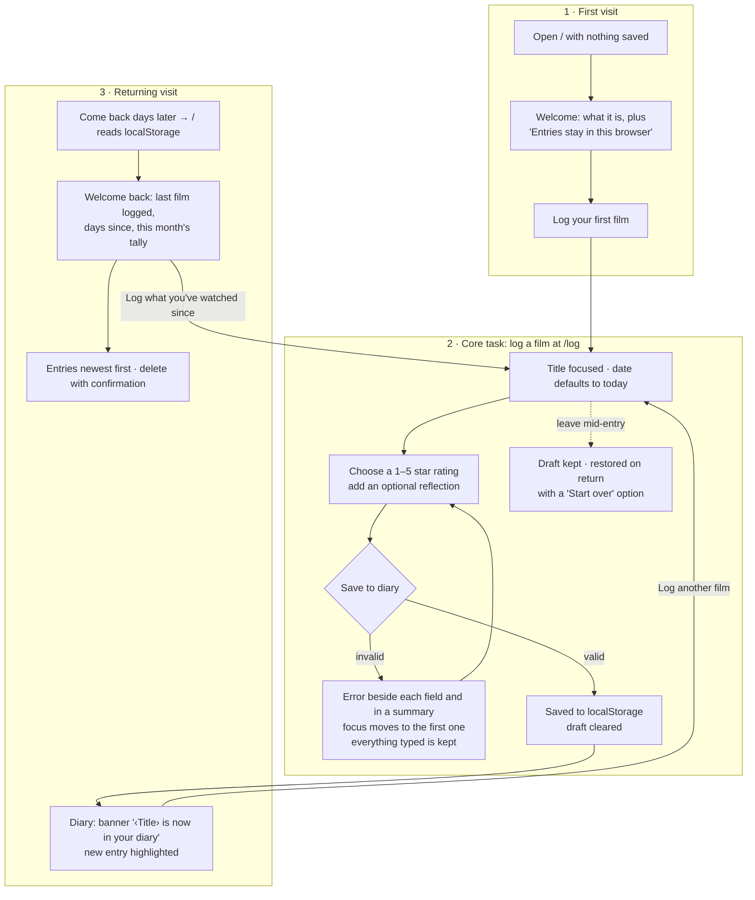

# After the Credits

A quiet, private diary for the films you've watched. Write down the title, when you saw it, a rating, and a line about how it stayed with you. Come back next week and it's all still there, saved only in your own browser.

Built for MPCS 51238 *Design, Build, Ship*, Assignment 3: "Patterns & Flows: An Everyday Tool". It uses Next.js (App Router), Tailwind CSS v4, and `localStorage`. There's no backend, no account and no external APIs.

- **Live:** https://after-the-credits-five.vercel.app
- **Repo:** https://github.com/ruitan01/after-the-credits

## Purpose and user

**Who it's for:** someone who watches a few films a month and wants a private record of what they saw and how it felt. They don't want a public profile, social features, or an account just to write two sentences.

**The job:** capture a film while it's still fresh, in under a minute, and find it again later.

**What brings them back:** the diary itself, a growing personal record. When they return, the app greets them with what they last logged, how long ago that was, and how many films they've logged this month, and then prompts them to log what they've watched since.

## Flows

> I watch a film → I log it while it's fresh → I come back next week, and it's still in my diary.



The diagram's source, with a table of every state on each route, is in [`docs/flows.md`](docs/flows.md).

| Step | Route | What happens |
|---|---|---|
| **1. First visit** | `/` | With nothing saved, the empty state *is* the onboarding: one sentence about what the diary is, a note that entries stay in this browser, and one button, **Log your first film**. There's no tour or sign-up. |
| **2. Core task** | `/log` | A single-column form: **Film title**, **Date watched** (defaults to today), **Rating** (1–5 stars, native radio buttons), and **Reflection** (optional, 500 characters). Errors sit under each field and say what to do next. A summary links to each error, and focus moves to the first one. What you typed is always kept, including as a draft if you leave the page. |
| **3. Coming back** | `/` | After a save: a confirmation banner with **Log another film**, and the new entry highlighted. On a later visit: **Welcome back**, the last film logged and how long ago, this month's tally, and a button to log what you've watched since. Entries are listed newest first and can be deleted with an inline confirmation. |

The shared header appears on every page: the wordmark, **Diary**, and **Log a film**. The current page is marked with `aria-current`.

## Run it

```bash
npm install
npm run dev      # http://localhost:3000
npm test         # Vitest: validation, dates, storage, drafts (23 tests)
npm run lint
npm run build
```

You'll need Node 18.18 or newer (tested with Node 24). To start fresh, clear this site's data in DevTools → Application → Local Storage.

## Onboarding research

Three subagents studied how **Letterboxd**, **Day One** and **The StoryGraph** welcome someone new: the first screen, what each asks for, and how soon you get something useful. All of the findings, each labelled verified, reported or assumption, are in [`docs/RESEARCH.md`](docs/RESEARCH.md). What we took from them:

- **Make the first log one action away.** Letterboxd's quick log and Day One's "+" led to one welcome button, then a one-screen form with one Save.
- **Ask only for what's essential.** StoryGraph makes every extra field optional, so only title, date and rating are required here, with whole stars.
- **Nothing before the first entry.** All three put accounts, paywalls, imports or surveys first, and we skip all of that.
- **Give a reason to return without being social.** Day One's "On This Day" and StoryGraph's stats led to our "Welcome back" summary.
- **Rejected:** Day One's pre-written sample entry. A made-up film in a personal diary would only confuse.

## First-run check: agent usability feedback

There were two rounds. The first ran locally before deployment and drove the fixes listed below. The second was the brief's Step 8, run on the **live site**.

### Round 2: live site (20 Oct 2026)

**Setup:**
- **Site:** https://after-the-credits-five.vercel.app (Next.js 15.5.28).
- **Browser:** the agent drove a separate browser (Edge 155, headless) through the DevTools protocol, using a **brand-new temporary profile**. That gave it empty localStorage without touching the owner's real browser or diary entries.
- **Input:** every step was done from the keyboard. The only exceptions were the native date picker's year/month/day segments, which were set by script.

**Goal:** *"You're new here. Log three films you watched recently, then come back later and keep using the diary."*

| Step | What the agent did | Result |
|---|---|---|
| First visit | Opened `/` with 0 localStorage keys | Welcome screen with one action. Tab order: Skip to content → wordmark → Diary → Log a film → **Log your first film** |
| Film 1 | Pressed Enter on the empty form | Summary "2 things need fixing", with "Enter the film's title." and "Choose a rating from 1 to 5." beside the fields. Focus went to Title |
| | Typed a title, tabbed past the rating, saved | Blocked with "Choose a rating from 1 to 5.". Focus went to the stars, and the **title, date and reflection were all kept** |
| | Space + arrow keys to 4 stars, saved | Summary and field error cleared. Focus moved to the banner "*Paris, Texas* is now in your diary." |
| Film 2 | Used **Log another film** from the banner | Opened `/log` with Title focused |
| | Future date + 532-character reflection | "That date hasn't happened yet." and "Keep your reflection under 500 characters (you're at 532)." beside each field. Counter red at 532 / 500, title kept |
| | Date in 1887 | "Films didn't exist before 1888. Check the year." |
| | Fixed both, saved | The 5-star rating had been kept throughout. Saved and listed by viewing date |
| Film 3 | Typed a title, left through the header, came back | **Draft restored** ("We kept the entry you hadn't saved yet." with Start over), saved with no reflection, draft cleared |
| Refresh | Reloaded `/` | All 3 entries still there, no flash of the empty state |
| Return later | Back-dated the test entries 3 days (temporary profile only) and reloaded | "**Welcome back** · You last logged *Paris, Texas* 3 days ago. That's 3 films so far in October." plus **Log what you've watched since** |
| Delete | Keyboard: Delete → (focus on **Keep it**) → Shift+Tab → Delete | Entry removed, "…was removed from your diary." announced, focus moved to the heading, and the deletion survived a reload |
| Labels | Checked every control | Film title, Date watched, Reflection (optional) each have a `<label>`, and Rating is a `fieldset` with a `legend` |
| Contrast | Scanned the computed colors of every visible text element on the diary, the delete confirmation and the form with errors | **No pair below 4.5:1.** The lowest was 7.3:1 (error summary text) |
| Responsive | 390 × 844 and 1440 × 900 | No horizontal scroll and 0 elements overflowing at 390px. The form stays one column |

**Agent feedback (live)**
- Every flow worked start to finish from the keyboard. The errors said exactly what to do next, and nothing had to be retyped after a mistake.
- Coming back feels designed: the "Welcome back" line says what you logged last and invites you to add what you've watched since.
- **Minor, not changed:**
  - When you save a film with an *older* viewing date, its highlighted card sits lower in the list. With three entries it's visible, but in a long diary it could be off-screen. The banner still confirms the save. A possible later tweak is to name the date in the banner ("filed under Wed, 14 Oct").
  - The native date input takes three Tab stops (year, month, day). That's standard browser behaviour, so it's left as is.
  - Refreshing minutes after logging still says "Welcome back… earlier today". It's accurate, just a little eager.
- No blocking issues, so **no code changes were needed after deployment.** Everything round 1 found was confirmed fixed on the live site.

### Round 1: local production build, before deployment

The agent used the app as a new user, keyboard only, against `next build && next start`, with the goal *"Log three films you watched recently, then come back later."*

| # | Finding | Change | Commit |
|---|---|---|---|
| 1 | Typing a title on `/log`, then clicking the header wordmark, **lost the entry silently**. Only "Back to diary" asked for confirmation. | The form saves a draft as you type, restores it on return with **Start over**, and clears it after saving. This replaced the `confirm()` prompt. | `fix: keep an unsaved entry as a draft…` |
| 2 | Coming back later looked **exactly like** the screen right after saving. Nothing acknowledged the return or gave a reason to keep going. | Added the **Welcome back** summary (last film logged, how long ago, this month's tally) and a prompt to log what you've watched since. | `feat: a returning-visit summary…` |
| 3 | To log the second and third films, you had to go back up to the header after every save. | The save banner offers **Log another film**. | `feat: a returning-visit summary…` |
| 4 | On the diary, nothing in the header showed **where you are**. | Added a **Diary** header link with `aria-current="page"`. | `a11y: show where you are…` |
| 5 | Buttons and fields were styled separately in each component. | Moved them into shared `Button`, `ButtonLink` and `Field` components (`components/ui.tsx`). | `refactor: shared Button…` |

**Considered, not changed:** the first visit needs one click (to `/log`) before you can type. An inline title field on the welcome screen would save that click, but it would split the form across two pages. The welcome screen already *is* that one action.

## Accessibility

- **Keyboard:** everything is reachable and usable by keyboard (checked locally and on the live site in the first-run checks above). There's a skip link, focus moves on route change and after errors, saves and deletes, and the native radio group handles the rating.
- **Labels:** every field has a visible `<label>`, with hints and errors linked through `aria-describedby`. Invalid fields get `aria-invalid`. Errors say "Error:" to screen readers and show a "!" icon, so they never rely on color alone.
- **Contrast:** the agent checked it with the WCAG 2.1 formula, including semi-transparent surfaces. On the live site, a scan of every visible text element found nothing below 7.3:1.

  | Pair | Ratio | Needs |
  |---|---|---|
  | Body text (ivory) on background | 16.5:1 | 4.5:1 |
  | Secondary text (parchment) on card | 8.8:1 | 4.5:1 |
  | Amber accent text on background | 10.2:1 | 4.5:1 |
  | Error text on error summary | 7.4:1 | 4.5:1 |
  | Button text on amber | 10.2:1 | 4.5:1 |
  | Input border on field / empty-star outline | 3.7:1 / 4.0:1 | 3:1 (non-text) |

- **Motion and layout:** `prefers-reduced-motion` turns off fades and the highlight glow. Checked at **390px** and **1440px**, locally and live, with no horizontal scroll and nothing overflowing.

## Decisions

- **Two routes.** `/` is the welcome, the diary and the returning view, depending on what's saved. `/log` is the form. A detail page or a separate onboarding route would add steps without adding value.
- **Storage** (`lib/entries.ts`):
  - Entries live under `after-the-credits:entries:v1`, and the draft under `after-the-credits:draft:v1`.
  - Every read validates the shape of each entry. If stored data can't be read, it's copied to `…:corrupt-<timestamp>` rather than deleted.
  - Every write re-reads storage first, so entries saved in another tab aren't overwritten.
  - If storage is blocked, the app shows a clear notice, and a failed save keeps everything typed.
- **Dates** are stored as local `YYYY-MM-DD` days, never UTC timestamps, so a late-evening viewing doesn't move to the next day.
- **Postponed:** editing, search and filters, half-star ratings, tags and posters, import/export, and fuller stats.

## How it was built (agentic workflow)

Every change was made by directing Claude Code. The `AGENTS.md` file gives coding agents the project's constraints, commands and conventions.

1. **Plan mode:** we defined the user, the three flows, routes, fields and error messages, scope cuts, and edge cases such as localStorage, dates and multiple tabs. The plan was approved before any code was written.
2. **Research:** an inline web pass first, then three parallel subagents during the audit (see above).
3. **Incremental build:** small conventional commits (scaffold → design tokens → storage → validation with tests → form → diary → delete). Tests, lint and build ran before commits.
4. **Browser QA:** the agent tested each flow in Chrome against production builds. This caught a real bug: the display fonts weren't loading. They're fixed in `fix: resolve display and body fonts…`.
5. **Compliance audit and first-run check** against the assignment brief. Its findings became the fixes listed above.
6. **Deployment:** Vercel blocked the first deploy because Next.js 15.5.4 was a vulnerable release. The fix upgraded to the patched 15.5.28 on the same 15.x line (`fix(deps): upgrade Next.js…`).
7. **Live first-run check** in an isolated browser profile. It found no blocking issues.

`git log --oneline` shows the full progression.

## Deployment

Deployed on Vercel's Hobby plan from `main`, with the framework preset (Next.js) and no environment variables or extra config. Every page is static (`○` in the build output). Pushing to `main` redeploys.
