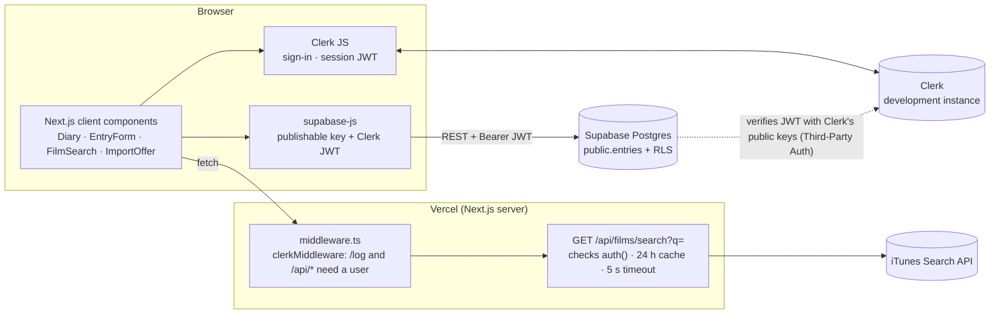
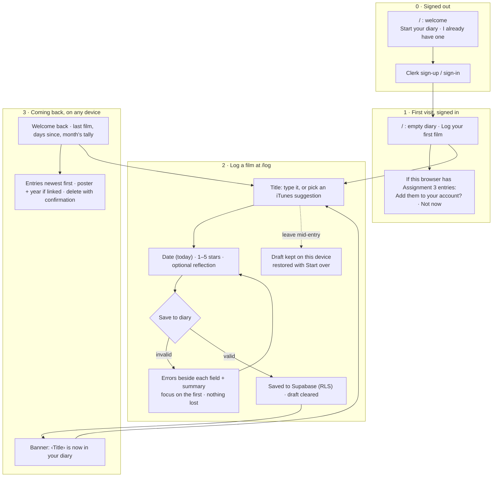

# After the Credits

A quiet, private diary for the films you've watched. Sign in, write down the title, when you saw it, a rating, and a line about how it stayed with you, and find it all again on any device. Only you can see your diary.

Built for MPCS 51238 *Design, Build, Ship*, **Assignment 4: "Full Stack App"**. It grows the Assignment 3 diary into a full-stack app with **Clerk** sign-in, a **Supabase** Postgres database protected by row-level security, and **iTunes Search** for finding films.

- **Assignment 4 (this branch, `assignment-4-fullstack`):** live URL added after deployment, in its own Vercel project
- **Assignment 3 (unchanged, `main`):** https://after-the-credits-five.vercel.app, with its README on [`main`](https://github.com/ruitan01/after-the-credits/blob/main/README.md)
- **Repo:** https://github.com/ruitan01/after-the-credits

## What's new since Assignment 3

| | Assignment 3 | Assignment 4 |
|---|---|---|
| Who | Anyone with the browser | A signed-in Clerk user |
| Where entries live | `localStorage`, one browser | Supabase Postgres, any device |
| Who can see them | Whoever uses that browser | Only their owner, enforced by row-level security |
| Finding a film | Type the title | Type it, or pick an iTunes suggestion with poster, year and director |
| Old entries | | Offered once: "N films are saved in this browser only. Add them to your account?" |

The flows, design tokens, form, validation messages and accessibility work from Assignment 3 are unchanged. New UI reuses the same `@theme` colors and `components/ui.tsx` primitives.

## Architecture



- **Identity: Clerk.** Sign-up, sign-in, sign-out and the user menu use Clerk's components, themed with the app's tokens. `middleware.ts` protects every route except `/`, `/sign-in` and `/sign-up`. `/` decides on the server: a signed-out visitor gets the welcome page and never receives diary data.
- **Data: Supabase, straight from the browser.** `lib/supabase.ts` creates the client with the **publishable key** and, for every request, the user's current Clerk session token. Supabase trusts Clerk through **Third-Party Auth**: it checks each token's signature against Clerk's public keys. No secret is shared between them.
- **Access control: row-level security, and nothing else.** No server code filters diary rows by user. Postgres decides, using the token's `sub` claim (the Clerk user id). The Supabase secret or service-role key isn't used anywhere.
- **Film search: one server route.** It's the only server-side code. See [Film search](#film-search-itunes) for why.

## Data model and security in the database

One table, `public.entries`, created by [`supabase/migrations/20261027190822_create_entries_table.sql`](supabase/migrations/20261027190822_create_entries_table.sql):

| Column | Type | Notes |
|---|---|---|
| `id` | `uuid` PK | `gen_random_uuid()`; imported entries keep their `localStorage` UUID |
| `user_id` | `text not null` | Defaults to `auth.jwt()->>'sub'`, the Clerk user id. The app never sends it |
| `title` | `text not null` | Not blank, at most 120 characters (same as the form) |
| `watched_on` | `date not null` | Local calendar day |
| `rating` | `smallint not null` | 1–5 |
| `reflection` | `text not null default ''` | At most 500 characters |
| `itunes_id`, `artwork_url`, `release_year` | nullable | Set only when the title was chosen from iTunes |
| `created_at` | `timestamptz` | When it was logged; kept on import |

- **RLS is on**, with one policy per action, all `to authenticated`, comparing `(select auth.jwt()->>'sub') = user_id`. Select uses `using`, insert uses `with check`, update uses both, and delete uses `using`.
- **Grants are explicit:**
  - Signed-out requests (`anon`) get nothing, so they fail with "permission denied" rather than an empty list.
  - Signed-in users can select, insert and delete, and can update only the seven content columns, never `id`, `user_id` or `created_at`.
  - Nobody gets `TRUNCATE`, which ignores RLS.
- **Index:** `(user_id, watched_on desc)`, matching the diary's order.
- The migration also revokes `EXECUTE` on the project's `rls_auto_enable()` event-trigger function from `PUBLIC`, so it can't be called through the API.

## Film search (iTunes)

Search is an **optional helper** on `/log`. Typing a title by hand always works, and nothing about search can stop a save.

- **Why a server route** (`app/api/films/search/route.ts`), even though iTunes needs no key:
  - It shrinks a ~450 KB response to a few KB.
  - It caches identical searches for a day.
  - Only signed-in users can use it, and it checks `auth()` itself, not only through middleware.
  - Apple's informal limit is about 20 requests a minute per IP, and on Vercel every user shares the server's IP. The cache, a 300 ms debounce, a 2-character minimum, cancelled stale requests and a per-tab cache keep requests low.
- **What we found** (re-checked 2026-10-27):
  - `media=movie` returns nothing, so we search `media=all` and keep `kind === "feature-movie"`.
  - Coverage is patchy: *Barbie* and *Amélie* are found, but *Inception*, *Aftersun* and *Past Lives* aren't.
  - "inception" returns 67 *unrelated* films. So results are filtered by title relevance:
    1. exact match;
    2. starts with the query, ignoring a leading "The";
    3. every typed word starts a title word, in any order;
    4. matches with spaces ignored.

    Anything else is dropped rather than shown to fill the list. At most 8 results are shown.
- **States:** loading, results, "No matches on iTunes. That's fine: keep typing and save it as is.", and "Film search isn't available right now. You can still type the title yourself." Network errors, timeouts, rate limits and bad responses all show that last message, and the typed title still saves.
- **The field:** an ARIA combobox. ↓/↑ move through the options, Enter chooses one (or submits, if none is highlighted), Esc closes the list, and Tab moves on. Focus stays in the input, and results are announced politely.
- **Choosing a film:** links it ("Linked to iTunes · 2023", with **Unlink**). The diary card then shows a small poster and the year. Editing the title removes the link. Unlinked entries look exactly as before.
- Posters are shown only from `https://*.mzstatic.com`. Any other URL is ignored.

## Bringing Assignment 3 entries along

Entries saved in a browser under `after-the-credits:entries:v1` belong to that browser, not an account. After sign-in, the diary offers: **"N films are saved in this browser only. Add them to your account?"**, with **Add them** and **Not now**.

- **Never automatic.** Nothing is imported or deleted until the user chooses **Add them**.
- **All or nothing, and safe to retry.**
  - One insert with "on conflict do nothing". Entries keep their UUIDs, and old non-UUID ids get a stable derived UUID, so retrying never duplicates.
  - The title, date, rating, reflection and original `created_at` are kept.
- **Only into your account.** After inserting, the ids are read back. RLS shows only the user's own rows, so if any belongs to another account, nothing is moved.
- **Backed up, never lost.** Only after everything succeeds is the original value copied to `…:entries:v1:imported-<timestamp>` and the original key removed. On any failure, `localStorage` is left exactly as it was.

## Flows



The Assignment 3 version of these flows, with a table of every state, is in [`docs/flows.md`](docs/flows.md).

## Run it locally

You need Node 18.18 or newer (tested with Node 24), a Clerk application (development instance), and a Supabase project with the migration above applied and Clerk added under **Authentication → Third-Party Auth**.

Create `.env.local` (git-ignored) with:

```
NEXT_PUBLIC_CLERK_PUBLISHABLE_KEY=pk_test_…
CLERK_SECRET_KEY=sk_test_…
NEXT_PUBLIC_SUPABASE_URL=https://<project>.supabase.co
NEXT_PUBLIC_SUPABASE_PUBLISHABLE_KEY=sb_publishable_…
```

Only the three `NEXT_PUBLIC_*` values reach the browser. `CLERK_SECRET_KEY` stays on the server.

```bash
npm install
npm run dev        # http://localhost:3000
npm test           # Vitest: 75 unit tests
npm run test:e2e   # Playwright: 43 end-to-end tests (setup in e2e/README.md)
npm run lint
npm run build      # stop `npm run dev` first: both use .next/
```

## Testing

- **Unit (Vitest, 75):**
  - **Search:** relevance and ranking, including the "inception" case; iTunes parsing and the poster-URL check.
  - **The search route:** 401, 400, 200, and 502 for network errors, timeouts, 429, 403, 5xx and bad bodies.
  - **Entries:** row mapping, the manual-entry fallback, drafts with and without a film, compatibility with Phase 2 rows and old drafts, every import path, and the combobox keyboard rules.
- **End-to-end (Playwright, 43):** runs on desktop and at 375 px and 320 px. It signs in two dedicated Clerk test users with one-time tickets and covers:
  - protected routes;
  - logging, reload, deletion, drafts, and the database being unavailable;
  - every search state, the keyboard, and manual entry when search fails;
  - the import;
  - no sideways scrolling on phones;
  - **two-user isolation**.

  Search is stubbed in the browser except for three live-iTunes tests. Test data is prefixed `E2E` and removed by the test that created it.
- **Isolation:** in both directions, user B can't see, read (by id, title or listing), update, delete, or insert as user A, and nobody can change `user_id`.
  - Every refusal is paired with the owner making the same request successfully, so an empty answer means RLS said no.
  - The test was **watched failing first**: `E2E_ISOLATION_SELF_CHECK=1` points "user B" at user A, and it fails at the first isolation check.
- **What the e2e run caught:** saving within a second or two of opening `/log`, before Clerk had loaded the session, showed a false "couldn't save". The form now waits for the session (`fix(log): wait for the Clerk session…`).

## Security review (Phase 6)

No exploitable issues were found.

- **Secrets:**
  - Only the Clerk publishable key, the Supabase URL and the Supabase publishable key reach the browser.
  - No secret appears in the client bundle, tracked files or git history.
  - `.env*`, `.mcp.json`, `e2e/.auth/` (saved sign-in state), `test-results/` and `playwright-report/` are git-ignored.
- **Agents** are denied read access to `.env` files (`.claude/settings.json`). The Supabase MCP server stays read-only except while an approved migration runs.
- **Accepted for this assignment:**
  - **The Clerk development instance:** it runs on the free tier and shows a development banner.
  - **Dependency advisories, fixed only by major upgrades:** `postcss` inside Next.js 15 (it only processes our own CSS at build time), and `vitest`/`tinypool` (dev-only, never deployed).
- **Left for later:**
  - Clerk's `createRouteMatcher` deprecation. Data never depends on middleware alone: RLS protects the diary, and the search route checks `auth()` itself.
  - An optional rewrite of the policies for Supabase's `auth_rls_initplan` performance warning, which looks like a false positive.

## Accessibility

Everything from Assignment 3 still applies:
- full keyboard use and a skip link;
- visible labels, with hints and errors linked by `aria-describedby`;
- errors that never rely on color alone;
- contrast of 7.3:1 or better for all text;
- `prefers-reduced-motion`.

New in Assignment 4:
- **The film search combobox** follows the ARIA 1.2 pattern, with live announcements.
- **Posters** are decorative (`alt=""`), because the title is always next to them.
- **Phones:** at 375 and 320 px there's no sideways scrolling, suggestions have 44 px touch targets, and inputs are 16 px so iOS doesn't zoom.

## Decisions

- **Browser to Supabase directly**, with RLS as the only gate, rather than API routes for diary data. It means less server code, and the database enforces privacy even if the app has a bug.
- **Third-Party Auth** rather than Clerk JWT templates, which are deprecated: no shared JWT secret, and Clerk's own session token is used.
- **`user_id` is `text`**, because Clerk ids look like `user_…`, not UUIDs. It's filled in by the database, never by the client.
- **The form draft stays in `localStorage`.** It's a per-device convenience, not diary data.
- **Postponed:** editing entries, filters and stats, half stars, tags, export, a production Clerk instance with a custom domain, and the dependency and middleware upgrades above.

## How it was built (agentic workflow)

Every change was made by directing Claude Code. `AGENTS.md` holds the constraints, architecture, data model, iTunes findings and conventions, and each phase needed the owner's go-ahead:

0. **Guardrails:** deny agent reads of `.env` files, and document the plan in `AGENTS.md`.
1. **Clerk:** provider, middleware, sign-in/up routes, and the header user menu.
2. **Supabase:** design reviewed first, then the migration applied through the MCP server (write access on only for that call), then verified with catalog queries, advisors and a forged-insert test. Then `lib/entries.ts` moved onto Supabase.
3. **Import** of `localStorage` entries.
4. **iTunes search:** the API was re-checked live, the plan approved, then built in six commits.
5. **Playwright:** 43 end-to-end tests, including two-user isolation that was watched failing first. They found one real bug, which was fixed.
6. **Security review,** then deployment to its own Vercel project.

`git log --oneline main..assignment-4-fullstack` shows the full progression.

## Deployment

Assignment 4 deploys as a **separate Vercel project** connected to the same GitHub repository, with **`assignment-4-fullstack` as its production branch**. The Assignment 3 project keeps deploying `main`, unchanged.

Environment variables (Production and Preview): `NEXT_PUBLIC_CLERK_PUBLISHABLE_KEY`, `CLERK_SECRET_KEY` (marked Sensitive), `NEXT_PUBLIC_SUPABASE_URL` and `NEXT_PUBLIC_SUPABASE_PUBLISHABLE_KEY`. No `E2E_*` values, and no Supabase secret key.
