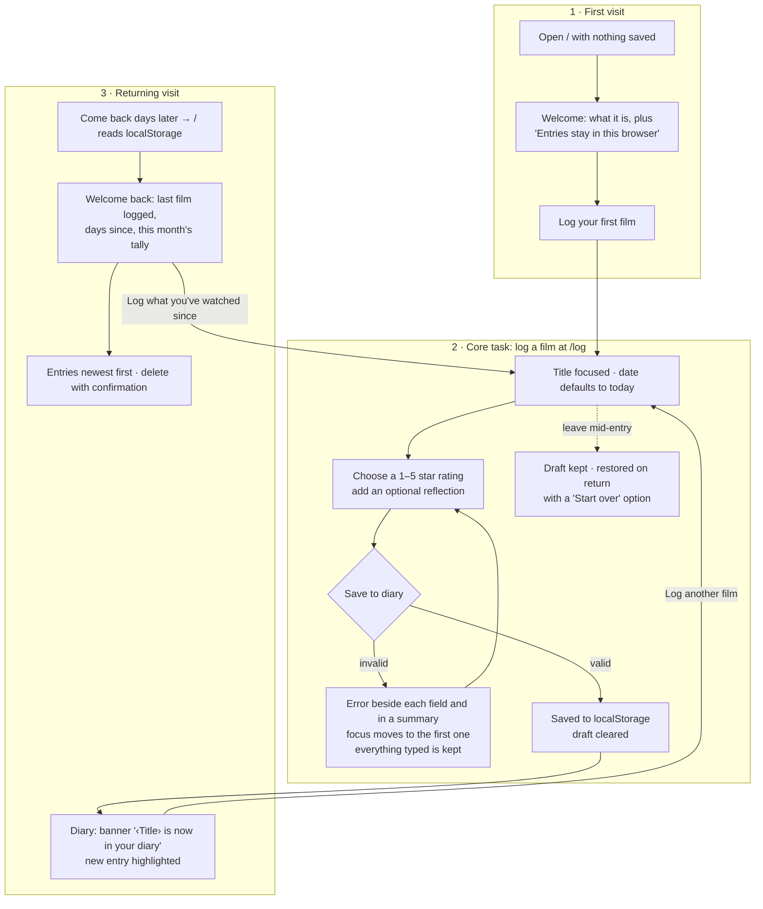

# After the Credits

A quiet, private diary for the films you've watched. Write down the title, when you saw it, a rating, and a line about how it stayed with you. Come back next week and it's all still there, saved only in your own browser.

Built for MPCS 51238 *Design, Build, Ship*, Assignment 3: "Patterns & Flows: An Everyday Tool". It uses Next.js (App Router), Tailwind CSS v4, and `localStorage`. There's no backend, no account and no external APIs.

- **Live:** _Vercel URL goes here after deployment_
- **Repo:** _GitHub URL goes here after the first push_

## Purpose and user

**Who it's for:** someone who watches a few films a month and wants a private record of what they saw and how it felt. They don't want a public profile, social features, or an account just to write two sentences.

**The job:** capture a film while it's still fresh, in under a minute, and find it again later.

**What brings them back:** the diary itself, a growing personal record. When they return, the app greets them with what they last logged, how long ago that was, and how many films they've logged this month, and then prompts them to log what they've watched since.

## Flows

> I watch a film → I log it while it's fresh → I come back next week, and it's still in my diary.



The diagram's source, with a table of every state on each route, is in [`docs/flows.md`](docs/flows.md).

| Step | Route | What happens |
|---|---|---|
| **1. First visit** | `/` | With nothing saved, the empty state *is* the onboarding: one sentence about what the diary is, a note that entries stay in this browser, and one button, **Log your first film**. There's no tour or sign-up. |
| **2. Core task** | `/log` | A single-column form: **Film title**, **Date watched** (defaults to today), **Rating** (1–5 stars, native radio buttons), and **Reflection** (optional, 500 characters). Errors sit under each field and say what to do next. A summary links to each error, and focus moves to the first one. What you typed is always kept, including as a draft if you leave the page. |
| **3. Coming back** | `/` | After a save: a confirmation banner with **Log another film**, and the new entry highlighted. On a later visit: **Welcome back**, the last film logged and how long ago, this month's tally, and a button to log what you've watched since. Entries are listed newest first and can be deleted with an inline confirmation. |

The shared header appears on every page: the wordmark, **Diary**, and **Log a film**. The current page is marked with `aria-current`.

## Run it

```bash
npm install
npm run dev      # http://localhost:3000
npm test         # Vitest: validation, dates, storage, drafts (23 tests)
npm run lint
npm run build
```

You'll need Node 18.18 or newer (tested with Node 24). To start fresh, clear this site's data in DevTools → Application → Local Storage.

## Onboarding research

Three subagents studied how **Letterboxd**, **Day One** and **The StoryGraph** welcome someone new: the first screen, what each asks for, and how soon you get something useful. All of the findings, each labelled verified, reported or assumption, are in [`docs/RESEARCH.md`](docs/RESEARCH.md). What we took from them:

- **Make the first log one action away.** Letterboxd's quick log and Day One's "+" led to one welcome button, then a one-screen form with one Save.
- **Ask only for what's essential.** StoryGraph makes every extra field optional, so only title, date and rating are required here, with whole stars.
- **Nothing before the first entry.** All three put accounts, paywalls, imports or surveys first, and we skip all of that.
- **Give a reason to return without being social.** Day One's "On This Day" and StoryGraph's stats led to our "Welcome back" summary.
- **Rejected:** Day One's pre-written sample entry. A made-up film in a personal diary would only confuse.

## First-run check: agent usability feedback

The coding agent used the app as a brand-new user, **keyboard only**, against a production build (`next build && next start`) in Chrome. The goal was: *"Log three films you watched recently, then come back later."* It went through the first visit and the main task, and then simulated returning days later by back-dating entries.

> **Note:** the brief asks for this check on the deployed URL. It will be repeated on the Vercel URL once the owner approves deployment, and this section will be updated.

**What worked**
- The first Tab reaches **Skip to content**, then the wordmark, **Log a film**, and **Log your first film**. Every step of every flow worked from the keyboard, including the rating (arrow keys move between stars, and the current star shows an amber focus ring).
- Submitting without a rating showed "Choose a rating from 1 to 5." beside the stars and in the summary, moved focus to the rating, and kept the title, date and reflection. The error cleared as soon as a star was picked.
- After a refresh the entries were still there, sorted by viewing date, with no flash of the empty state.

**What it found, and what changed**
| # | Finding | Change | Commit |
|---|---|---|---|
| 1 | Typing a title on `/log`, then clicking the header wordmark, **lost the entry silently**. Only "Back to diary" asked for confirmation. | The form saves a draft as you type, restores it on return with **Start over**, and clears it after saving. This replaced the `confirm()` prompt. | `fix: keep an unsaved entry as a draft…` |
| 2 | Coming back later looked **exactly like** the screen right after saving. Nothing acknowledged the return or gave a reason to keep going. | Added the **Welcome back** summary (last film logged, how long ago, this month's tally) and a prompt to log what you've watched since. | `feat: a returning-visit summary…` |
| 3 | To log the second and third films, you had to go back up to the header after every save. | The save banner offers **Log another film**. | `feat: a returning-visit summary…` |
| 4 | On the diary, nothing in the header showed **where you are**. | Added a **Diary** header link with `aria-current="page"`. | `a11y: show where you are…` |
| 5 | Buttons and fields were styled separately in each component. | Moved them into shared `Button`, `ButtonLink` and `Field` components (`components/ui.tsx`). | `refactor: shared Button…` |

**Considered, not changed:** the first visit needs one click (to `/log`) before you can type. An inline title field on the welcome screen would save that click, but it would split the form across two pages. The welcome screen already *is* that one action.

## Accessibility

- **Keyboard:** everything is reachable and usable by keyboard (checked in the first-run check above). There's a skip link, focus moves on route change and after errors, saves and deletes, and the native radio group handles the rating.
- **Labels:** every field has a visible `<label>`, with hints and errors linked through `aria-describedby`. Invalid fields get `aria-invalid`. Errors say "Error:" to screen readers and show a "!" icon, so they never rely on color alone.
- **Contrast** (checked by the agent with the WCAG 2.1 formula, including semi-transparent surfaces):

  | Pair | Ratio | Needs |
  |---|---|---|
  | Body text (ivory) on background | 16.5:1 | 4.5:1 |
  | Secondary text (parchment) on card | 8.8:1 | 4.5:1 |
  | Amber accent text on background | 10.2:1 | 4.5:1 |
  | Error text on error summary | 7.4:1 | 4.5:1 |
  | Button text on amber | 10.2:1 | 4.5:1 |
  | Input border on field / empty-star outline | 3.7:1 / 4.0:1 | 3:1 (non-text) |

- **Motion and layout:** `prefers-reduced-motion` turns off fades and the highlight glow. Checked at **390px** and **1440px** with no horizontal scroll and nothing overflowing.

## Decisions

- **Two routes.** `/` is the welcome, the diary and the returning view, depending on what's saved. `/log` is the form. A detail page or a separate onboarding route would add steps without adding value.
- **Storage** (`lib/entries.ts`):
  - Entries live under `after-the-credits:entries:v1`, and the draft under `after-the-credits:draft:v1`.
  - Every read validates the shape of each entry. If stored data can't be read, it's copied to `…:corrupt-<timestamp>` rather than deleted.
  - Every write re-reads storage first, so entries saved in another tab aren't overwritten.
  - If storage is blocked, the app shows a clear notice, and a failed save keeps everything typed.
- **Dates** are stored as local `YYYY-MM-DD` days, never UTC timestamps, so a late-evening viewing doesn't move to the next day.
- **Postponed:** editing, search and filters, half-star ratings, tags and posters, import/export, and fuller stats.

## How it was built (agentic workflow)

Every change was made by directing Claude Code. The `AGENTS.md` file gives coding agents the project's constraints, commands and conventions.

1. **Plan mode:** we defined the user, the three flows, routes, fields and error messages, scope cuts, and edge cases such as localStorage, dates and multiple tabs. The plan was approved before any code was written.
2. **Research:** an inline web pass first, then three parallel subagents during the audit (see above).
3. **Incremental build:** small conventional commits (scaffold → design tokens → storage → validation with tests → form → diary → delete). Tests, lint and build ran before commits.
4. **Browser QA:** the agent tested each flow in Chrome against production builds. This caught a real bug: the display fonts weren't loading. They're fixed in `fix: resolve display and body fonts…`.
5. **Compliance audit and first-run check** against the assignment brief. Its findings became the fixes listed above.

`git log --oneline` shows the full progression.

## Deploying (pending approval)

The app is a fully static Next.js build, so Vercel's defaults work without any config:
1. Create an empty GitHub repo, then run `git remote add origin <url>` and `git push -u origin main`.
2. On Vercel, choose **New Project**, import the repo, and keep the framework preset (Next.js). Leave the build command and output as they are. No environment variables are needed.
3. Paste both URLs at the top of this README, then repeat the first-run check on the live URL.
