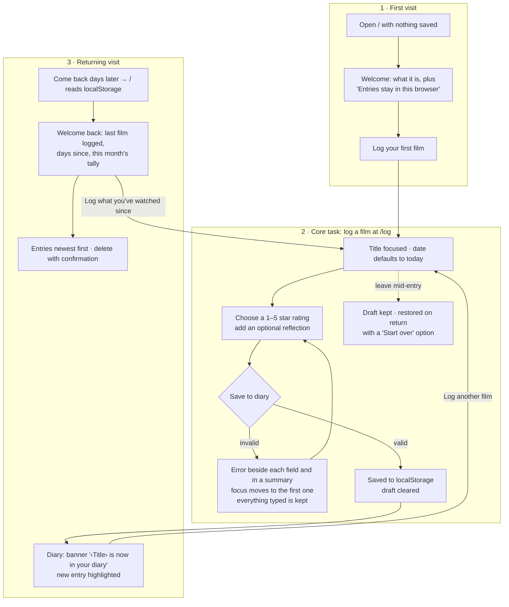

# User flows

**The main task in one sentence:**
I watch a film → I log it while it's fresh → I come back next week, and it's still in my diary.

| Step | Route | Key states |
|---|---|---|
| First visit | `/` | loading placeholder → welcome (empty state is the onboarding) |
| Log a film | `/log` | empty · restored draft · field errors + summary · saving · storage-write failure |
| Diary | `/` | just-saved banner · welcome back · deleted notice · corrupt data set aside · storage blocked |
